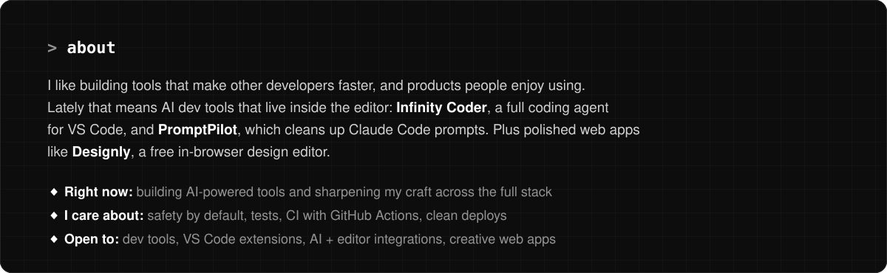
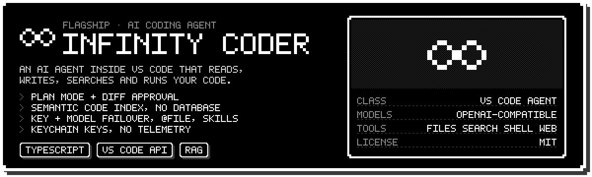
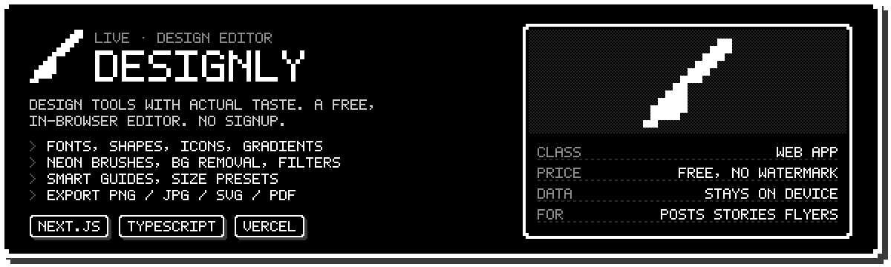
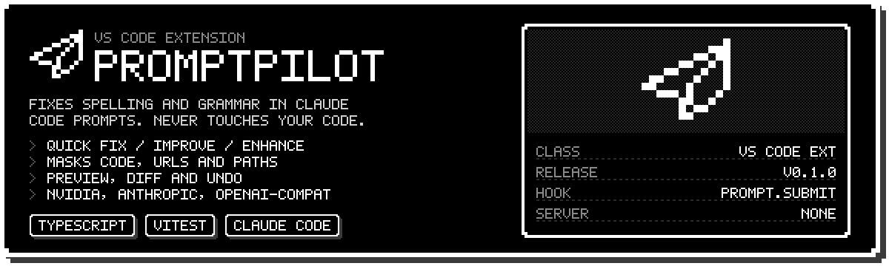
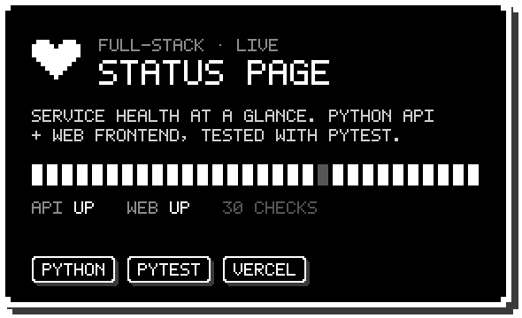
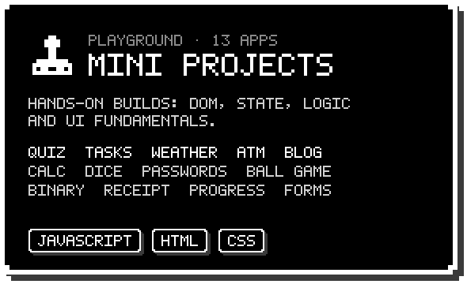
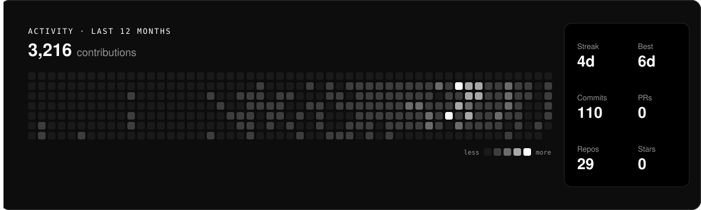

<!-- Profile README for github.com/UtkarshloneyaITG
     Setup: create a public repo named exactly "UtkarshloneyaITG",
     upload this README.md, the assets/ and scripts/ folders, and .github/workflows/activity.yml. -->

  

  
  

  

### `> featured work`

  

  

  

  
  

  <a href="https://designly-psi.vercel.app"><b>Try Designly →</b></a>
  &nbsp;·&nbsp;
  <a href="https://github.com/gamith24/Infinity-Coder"><b>Infinity Coder →</b></a>
  &nbsp;·&nbsp;
  <a href="https://status-page-three-ashy.vercel.app"><b>Status Page demo →</b></a>

### `> stack`

  
  
  
  
  
  
  
  
  
  
  
  

### `> activity`

<!-- assets/activity.svg is regenerated daily by .github/workflows/activity.yml -->

  

<code>$ exit 0</code> · thanks for stopping by

